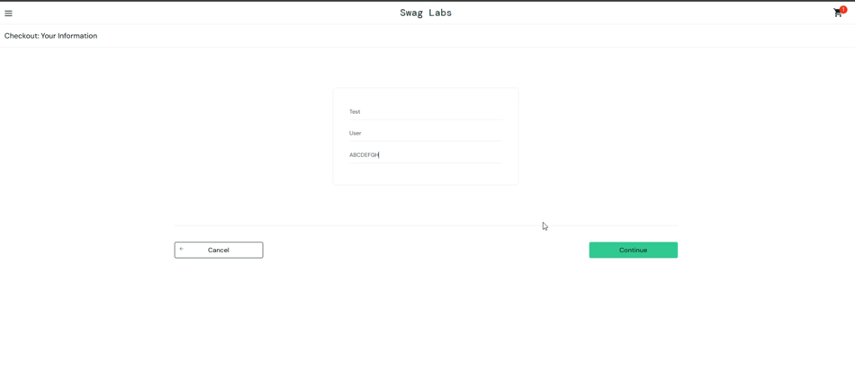
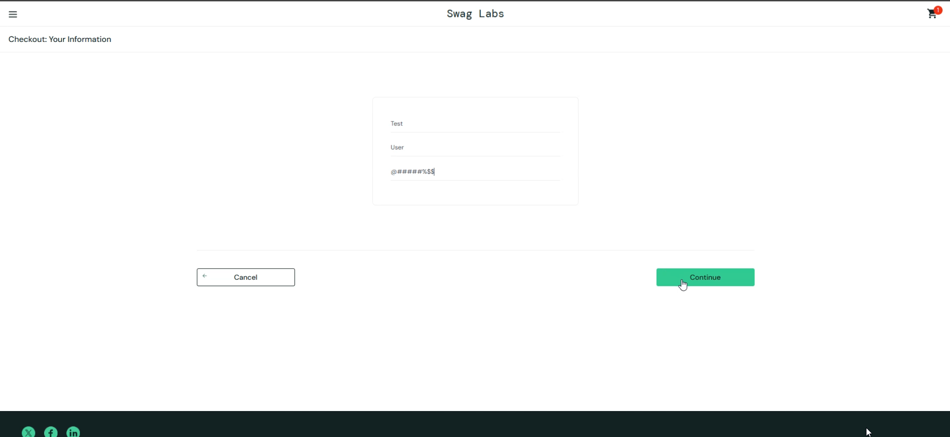
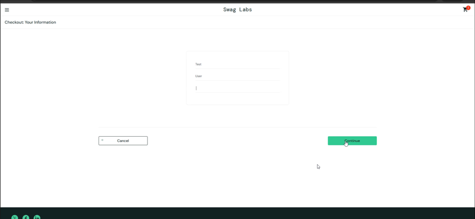
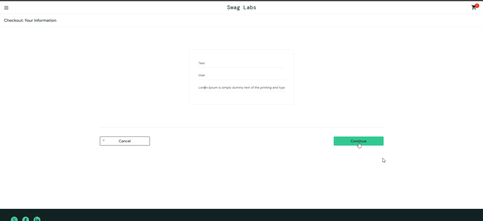

# Bug Report: Postal Code Accepts Invalid Input

| Item | Value |
|---|---|
| Bug ID | BUG-CHK-002 |
| Title | Postal Code accepts alphabetic characters, special characters, spaces and long input |
| Severity | Low (proposed) |
| Priority | Low (proposed) |
| Environment | Sauce Demo (https://www.saucedemo.com); browser and OS details were not recorded |
| Related test cases | TC-CHK-015, TC-CHK-016, TC-CHK-017 |
| Status | Needs clarification |

## Preconditions

- User is logged in.
- At least one product has been added to the shopping cart.
- User is on the Your Cart page.

## Test Data

| Case | Postal Code Input |
|---|---|
| 1. Alphabetic characters | `ABCDEF` |
| 2. Special characters | `@#$%&` |
| 3. Whitespace only | Spaces only |
| 4. Long input | More than 255 characters |

## Steps to Reproduce

1. Log in to Sauce Demo.
2. Add a product to the shopping cart.
3. Open the shopping cart.
4. Click **Checkout**.
5. Enter the following information:
   - First Name: `Test`
   - Last Name: `User`
   - Postal Code: Use one of the four test data values above.
6. Click **Continue**.
7. Observe the navigation result.
8. Repeat the test with the remaining three Postal Code values.

## Actual Result

- All four input cases are accepted by the Postal Code field.
- Clicking Continue successfully navigates to the Checkout: Overview page.
- No validation error is displayed for these four input cases.
- The checkout process proceeds to the overview screen.

## Expected Result

- The application should validate Postal Code input according to the business rules defined by the product.
- Invalid formats, whitespace-only values and excessively long values should be handled according to the confirmed validation requirements.
- The expected Postal Code format and maximum length require Product Owner clarification because no explicit requirements have been provided.

## Evidence

### 1. Alphabetic Postal Code

### 2. Special Characters Postal Code

### 3. Whitespace-only Postal Code

### 4. Long Postal Code

## Video Evidence

[Watch BUG-CHK-002 reproduction](https://youtu.be/xbPYQEFL_eY)

## Related Test Cases

- TC-CHK-015: Postal Code accepts alphabetic and special characters.
- TC-CHK-016: Checkout form accepts whitespace-only input.
- TC-CHK-017: Checkout form accepts input longer than 255 characters.

## Notes

- The scope of this bug report is limited to the Postal Code field.
- All four cases successfully navigated to Checkout Overview during testing.
- Severity and Priority are proposed values and require confirmation.
- Further clarification from the Product Owner is required to determine the expected Postal Code format and maximum length.
