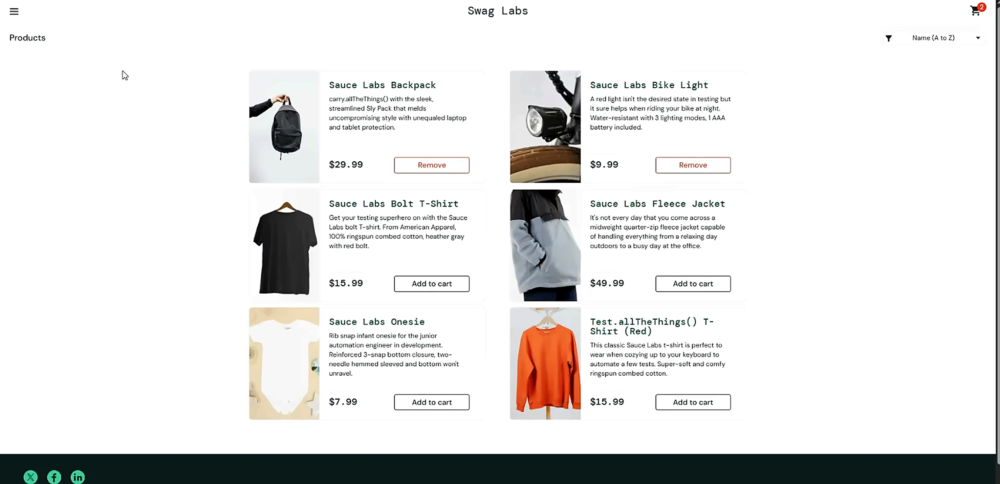
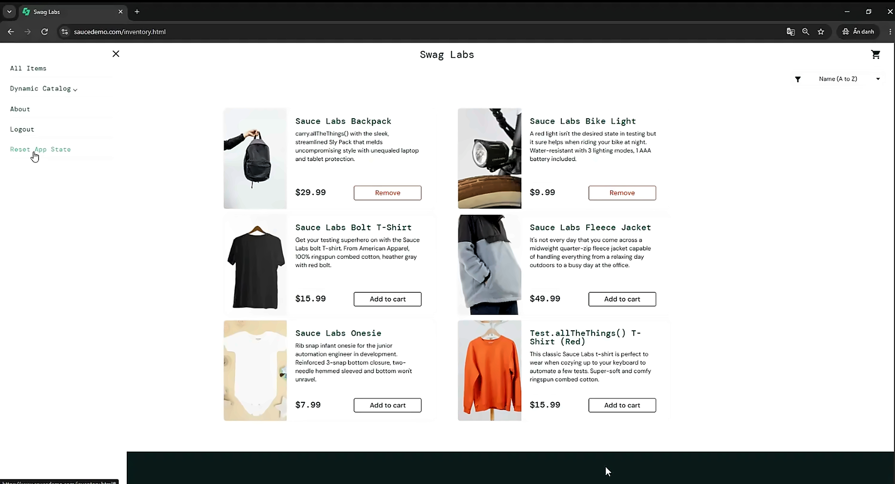

# Bug Report: Reset App State Does Not Update Product Buttons
 
| Item | Value |
|---|---|
| Bug ID | BUG-MENU-001 |
| Title | Product buttons remain "Remove" after Reset App State until the page is reloaded |
| Severity | Low (proposed) |
| Priority | Low (proposed) |
| Environment | Sauce Demo (https://www.saucedemo.com); Google Chrome (incognito window); browser version and OS details were not recorded |
| Related test case | TC-MENU-005 |
| Status | Needs clarification |
 
## Preconditions
 
- User is logged in as `standard_user`.
- User is on the Products page.
## Steps to Reproduce
 
1. On the Products page, click **Add to cart** for two products (for example, Sauce Labs Backpack and Sauce Labs Bike Light).
2. Observe that the cart badge shows 2 and both buttons change to **Remove**.
3. Open the menu and click **Reset App State**.
4. Stay on the Products page and observe the cart badge, the product buttons and the menu.
5. Press F5 to reload the page and observe the product buttons again.
## Actual Result
 
- After clicking Reset App State, the cart badge disappears.
- Both product buttons still show **Remove**.
- The menu stays open.
- Opening the cart shows that it is empty.
- The buttons return to **Add to cart** only after the page is reloaded (F5) or after leaving the Products page and returning to it.
## Expected Result
 
- By common e-commerce convention, the product buttons should return to **Add to cart** immediately after the cart is reset, so the page matches the empty cart.
- No explicit requirement for Reset App State behavior is available. Product Owner clarification is needed to confirm the expected behavior, including whether the menu should close after the action.
## Evidence
 
### 1. Before Reset App State
 

 
### 2. After Reset App State (buttons still show Remove, menu still open)
 

 
## Related Test Cases
 
- TC-MENU-005: Reset App State leaves product buttons in the Remove state.
## Notes
 
- The cart contents and the cart badge are reset correctly; the inconsistency is in the product buttons on the current page.
- The menu staying open after Reset App State is recorded as an observation only, pending clarification.
- Severity and Priority are proposed values and require confirmation.
- The expected behavior is based on common e-commerce convention because no explicit requirement is available.
