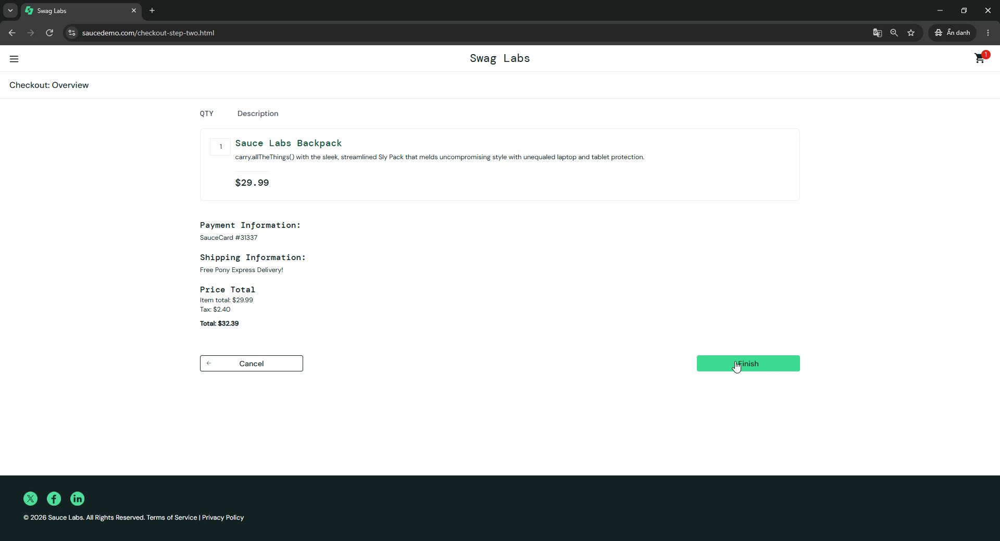

# BUG-USER-001: error_user cannot complete checkout (Finish button does nothing)

| Field | Value |
|---|---|
| Bug ID | BUG-USER-001 |
| Jira issue | PROJECT-17 |
| Severity | High (proposed) |
| Status | Open |
| Linked test case | TC-USER-007 |
| Reported | 2026-11-09 |
| Environment | https://www.saucedemo.com, Google Chrome (desktop) |
| Test account | `error_user` / `secret_sauce` |

## Summary

When logged in as `error_user`, clicking **Finish** on the Checkout: Overview page does nothing. The user stays on the Overview page, no error message is shown, and the order cannot be completed.

## Preconditions

- Logged in as `error_user`.
- Cart contains 1 product (Sauce Labs Backpack).

## Steps to reproduce

1. Open https://www.saucedemo.com and log in with `error_user` / `secret_sauce`.
2. Add **Sauce Labs Backpack** to the cart.
3. Open the cart and click **Checkout**.
4. Enter First Name `Test`, Last Name `User`, Postal Code `12345`, then click **Continue**.
5. On Checkout: Overview, click **Finish** and wait about 5 seconds.
6. Click **Finish** again.

## Expected result

Based on common e-commerce convention, clicking **Finish** completes the order and opens the "Checkout: Complete" page ("Thank you for your order!"). If the order cannot be completed, the user sees a clear error message.

## Actual result

- The URL does not change (stays `checkout-step-two.html`).
- No error message or other feedback is shown.
- The page stays on Checkout: Overview.
- Clicking **Finish** again gives the same result.

## Control check

With `standard_user`, using the same steps and the same product, **Finish** opens the "Checkout: Complete" page. The problem is specific to `error_user`.

## Impact

The user cannot finish a purchase and gets no feedback about why. This blocks the main checkout flow for this account.

## Evidence

Before clicking Finish:

After clicking Finish (still on Overview, URL unchanged):

## Notes

- `error_user` is one of the special test accounts on this site. This behavior is assumed to be a known, intentional defect of that account; this was not checked against any documentation.
- Expected result is based on common e-commerce convention, not on a written requirement.
- Severity is a proposal and can be adjusted after review.
